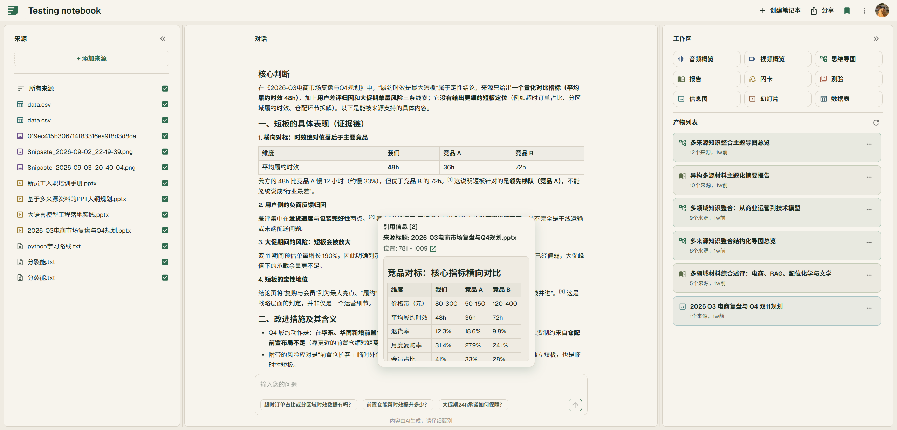
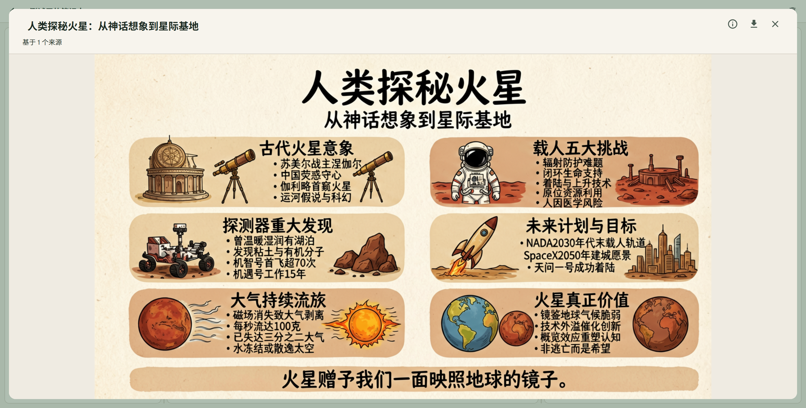
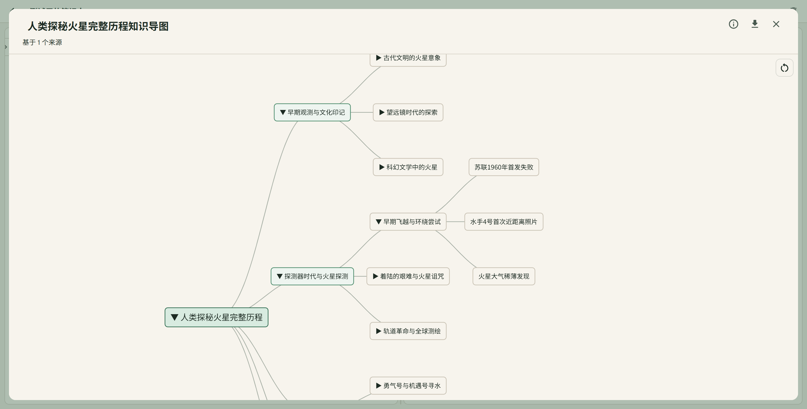
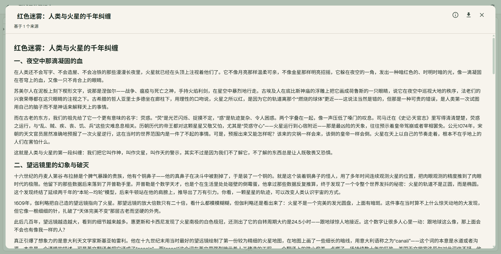
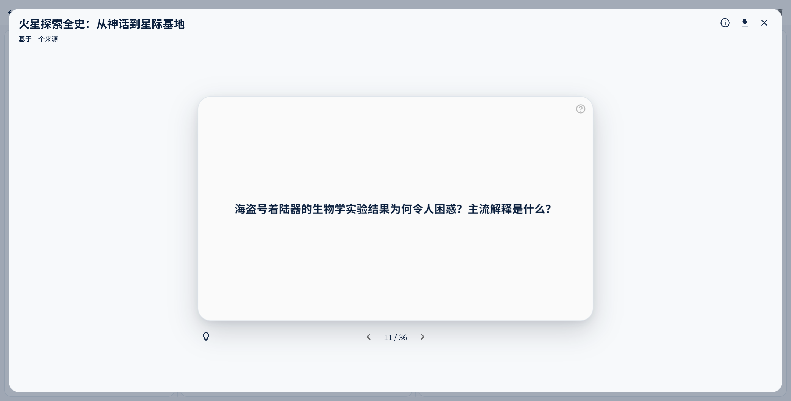
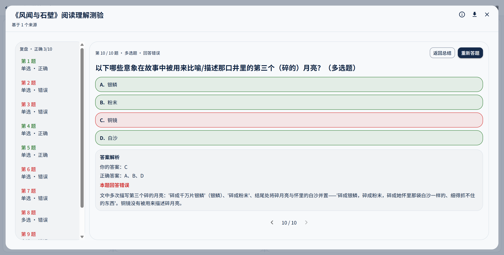
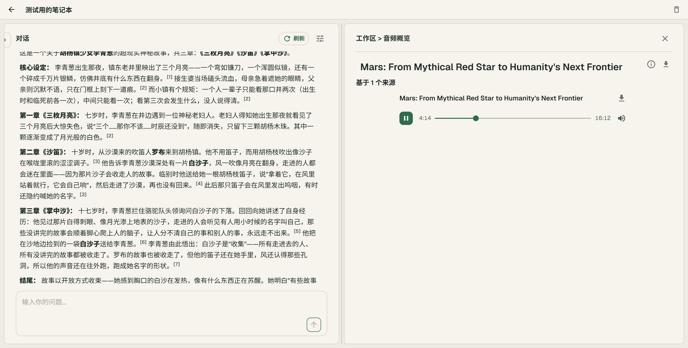
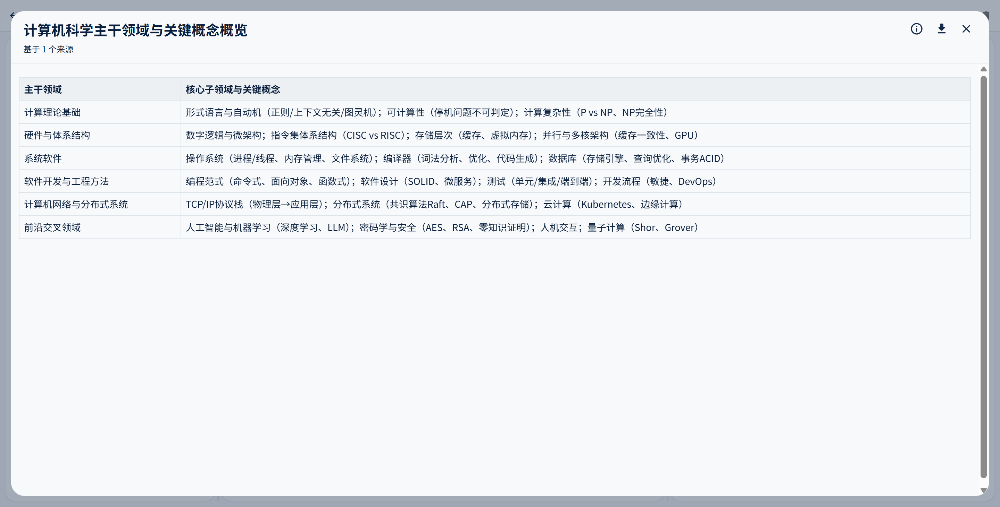
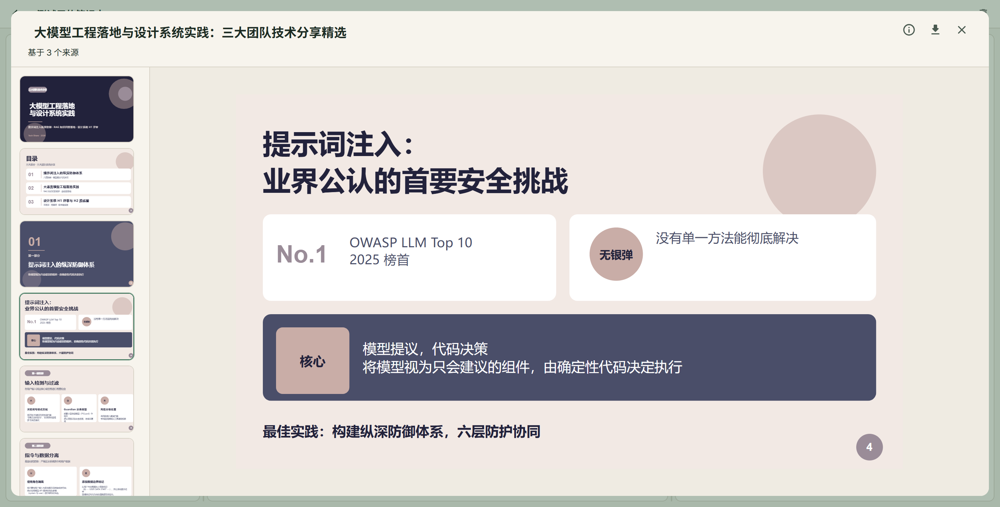
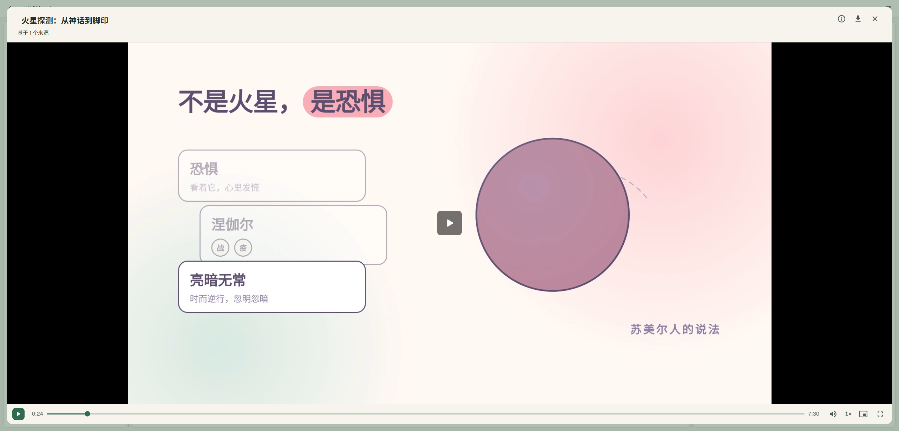

<a id="readme-top"></a>


<br />
<div align="center">
  <picture>
    <source media="(prefers-color-scheme: dark)" srcset="docs/readme/hero-dark.svg" />
    
  </picture>
</div>

<br />
<br />

[](https://goreportcard.com/report/github.com/gonotelm-lab/gonotelm)
[](https://github.com/gonotelm-lab/gonotelm/actions/workflows/ci.yml)
[](https://codecov.io/gh/gonotelm-lab/gonotelm)

[English](README.md) | 简体中文

## GoNoteLM

PDF、链接、笔记这些零散资料，GoNoteLM 能帮你真正读透。上传之后想怎么问都行，AI 会去检索、给出引用并讲清楚；思维导图、报告、测验、播客、视频几秒钟就能生成。学得快，也记得住，一个地方全都有。



### 核心能力

- **笔记本** — 科目、项目、论文各建一个笔记本，资料、回答和历史记录都在里面，需要时随时能找到。
- **资料导入** — 支持文本、URL、PDF、Markdown、EPUB、Word、CSV、XLSX，解析交给 GoNoteLM。
- **Agentic RAG 对话** — 不用自己翻资料，有问题直接问。AI 从你的资料里找答案，标注引用，边生成边输出；思考模式会展示推理过程，对话风格也能按习惯切换。
- **AI 工作室** — 用资料一键生成思维导图、报告、信息图、音频概览、视频概览、记忆卡片、测验、数据表、幻灯片，AI 的回复也能存成笔记，让积累的知识真正用起来。

## 生成效果

<table width="100%" border="1" cellspacing="0" cellpadding="8">
  <tbody>
    <tr>
      <td align="center" valign="top">
        <br />
        <sub>信息图</sub>
      </td>
      <td align="center" valign="top">
        <br />
        <sub>思维导图</sub>
      </td>
      <td align="center" valign="top">
        <br />
        <sub>报告</sub>
      </td>
    </tr>
    <tr>
      <td align="center" valign="top">
        <br />
        <sub>记忆卡片</sub>
      </td>
      <td align="center" valign="top">
        <br />
        <sub>测验</sub>
      </td>
      <td align="center" valign="top">
        <br />
        <sub>音频概览</sub>
      </td>
    </tr>
    <tr>
      <td align="center" valign="top">
        <br />
        <sub>数据表</sub>
      </td>
      <td align="center" valign="top">
        <br />
        <sub>幻灯片</sub>
      </td>
      <td align="center" valign="top">
        <br />
        <sub>视频概览</sub>
      </td>
    </tr>
  </tbody>
</table>

## 本地启动

需要 Go（版本见 `go.mod`）、Docker Compose 和 `make`。

### 最小环境变量

把 [`.env.minimum`](.env.minimum) 里的 key 复制进 `.env` 并填值，其余变量留空即可，会回退到 `etc/*.toml.tpl` 的默认值。这些 key 为空时，`make dev-up` 或对应进程会直接启动失败。完整清单和注释见 [`.env.example`](.env.example)。

```bash
# 1. 配置环境变量（必需项见 .env.minimum）
cp .env.example .env

# 2. 启动本地中间件：postgres / redis / clickhouse / kafka / minio / milvus / flow-server（默认还会启动 jaeger）
make dev-up            # 不需要 jaeger 时用 make dev-up-notrace；停止用 make dev-down

# 3. 初始化数据库（仅首次）
make dev-migrate

# 4. 导入业务数据：样式预览素材（一次性任务，在仓库根目录执行）
make run-initjob

# 5. 启动服务，每个服务单独占一个终端
make run-notelm        # HTTP API，默认监听 :7099
make run-worker        # 异步生成任务（AI 工作室）
make run-sourcejob     # 资料导入任务
```

`make run-initjob` 是一次性任务，执行完自动退出。退出码非零表示有任务失败或者中途被中断；再次执行时只会补跑尚未成功的任务。它上传的素材来自 `./assets`（可以用 `-assets-dir` 指定其他目录），因此必须在仓库根目录执行。

Web UI 单独放在仓库 [gonotelm-lab/gonotelm-web](https://github.com/gonotelm-lab/gonotelm-web) 里：

```bash
# 6. 启动 Web UI（要求 Node.js 20.19+ 或 22.12+，并安装 pnpm）
git clone https://github.com/gonotelm-lab/gonotelm-web.git
cd gonotelm-web
pnpm install
pnpm dev               # Vite 开发服务器监听 :5173，并将 /api 代理到 http://127.0.0.1:7099
```

如果要连接其他后端，这样启动：`VITE_BACKEND_PROXY_TARGET=http://host:port pnpm dev`。

`run-*` 系列命令会自动读取 `.env`，如果 shell 里导出过同名变量，以 shell 的值为准。中间件的端口会映射到宿主机，必须与 `.env` 中 `GONOTELM_*` 配置的地址保持一致。端口清单、数据卷复用方式，以及如何与本地已有的环境并行运行，见 [deploy/dev/README.md](deploy/dev/README.md)。

## OAuth 与集成配置

邮箱 + 密码登录不需要额外配置。三方登录则要先配好凭证，登录入口才会出现。

### GitHub

新建一个 GitHub OAuth App，callback 填：

```text
http(s)://YOUR_DOMAIN/api/v1/auth/callback/github
```

本地开发时，Homepage URL 填 `http://127.0.0.1:5173`，然后配置环境变量：

```env
GONOTELM_OAUTH_GITHUB_CLIENT_ID=...
GONOTELM_OAUTH_GITHUB_CLIENT_SECRET=...
```

只有当 callback 不是默认的本地地址（`http://127.0.0.1:7099/api/v1/auth/callback/github`）时，才需要设置 `GONOTELM_OAUTH_GITHUB_REDIRECT_URI`。分步操作（带截图）、生产环境配置和常见问题见 [docs/oauth-setup/github](docs/oauth-setup/github/README-zh.md)。

### Google

在 [Google Auth Platform](https://console.cloud.google.com/auth/clients?project=YOUR_PROJECT_ID)（把 `YOUR_PROJECT_ID` 换成实际的项目 ID）创建一个 **Web application** 类型的 OAuth client，redirect URI 填：

```text
http(s)://YOUR_DOMAIN/api/v1/auth/callback/google
```

然后配置环境变量：

```env
GONOTELM_OAUTH_GOOGLE_CLIENT_ID=...
GONOTELM_OAUTH_GOOGLE_CLIENT_SECRET=...
```

线上部署时，把 `GONOTELM_OAUTH_GOOGLE_REDIRECT_URI` 设为同一个地址；本地开发默认使用 `http://127.0.0.1:7099/api/v1/auth/callback/google`。OAuth 同意屏幕、生产环境配置和常见问题见 [docs/oauth-setup/google](docs/oauth-setup/google/README-zh.md)。
