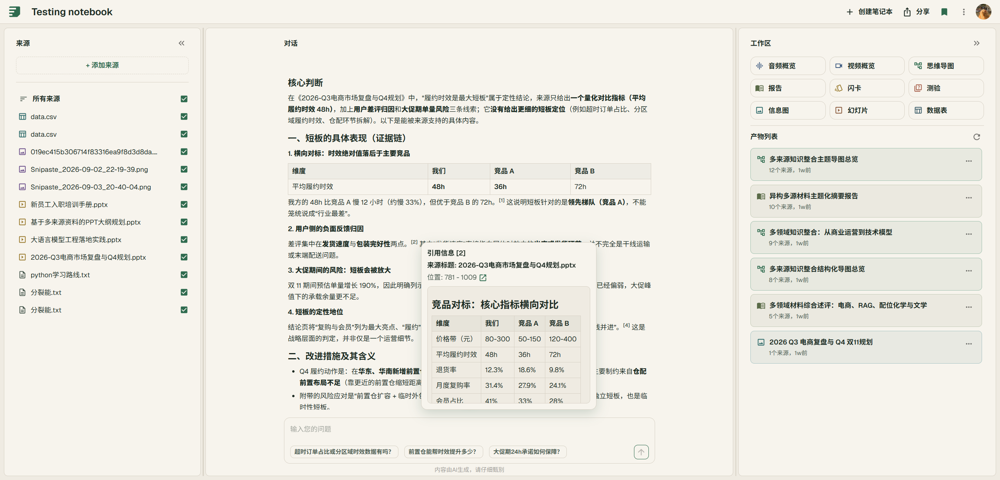
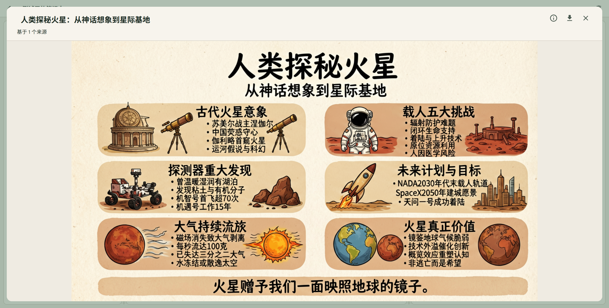
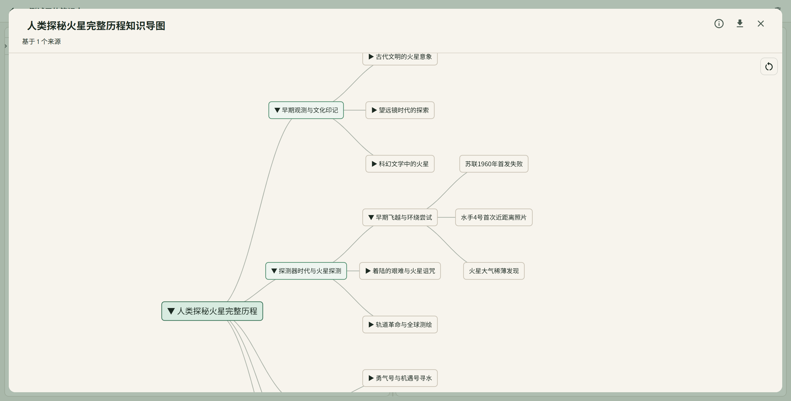
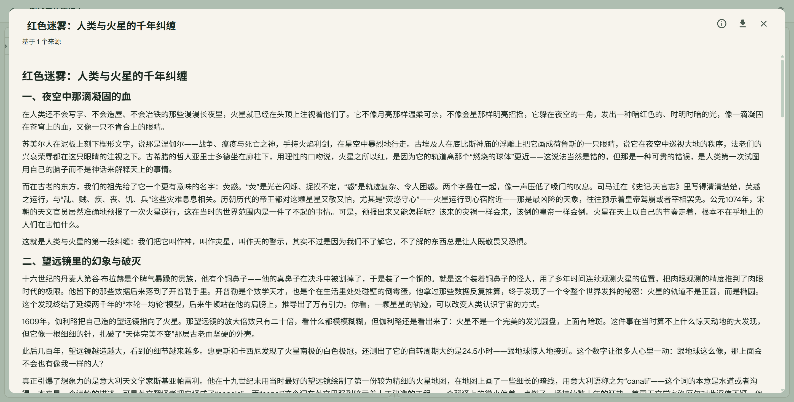
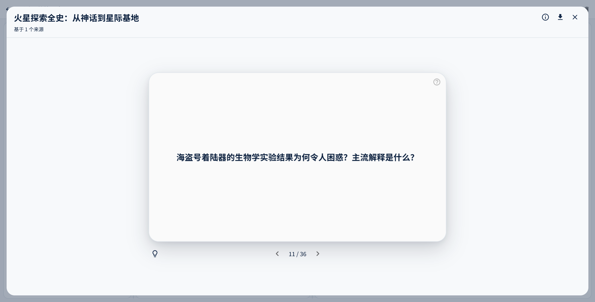
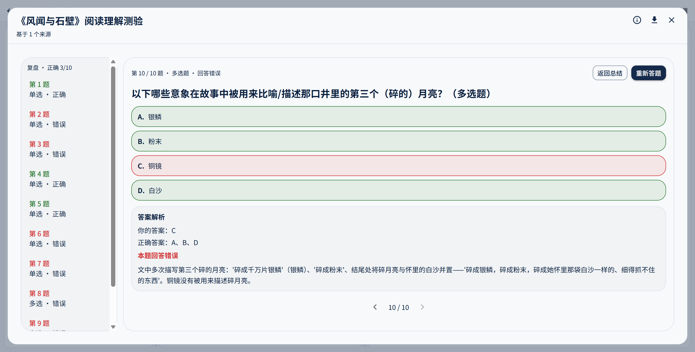
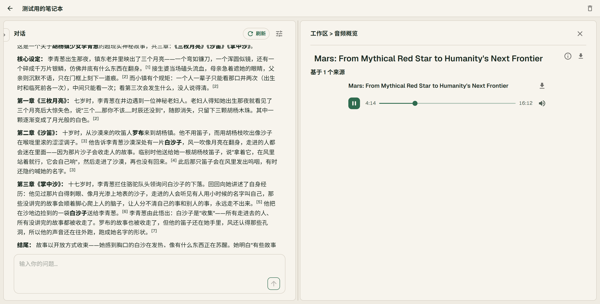
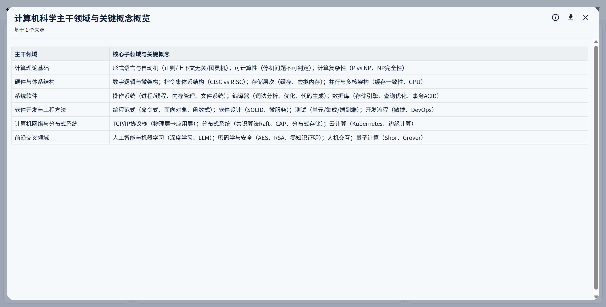
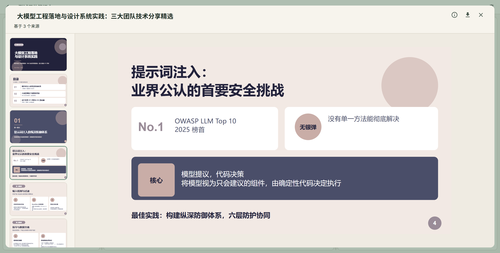
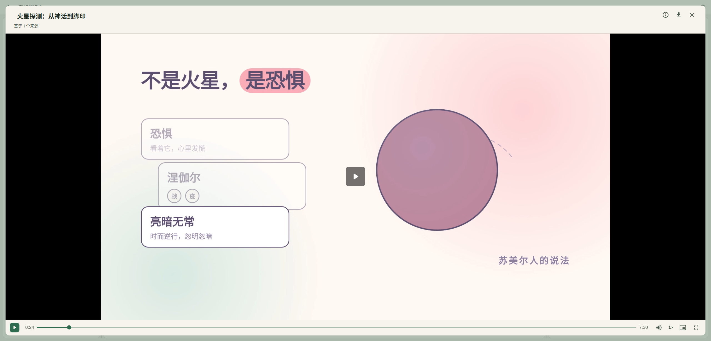

<a id="readme-top"></a>


<br />
<div align="center">
  <picture>
    <source media="(prefers-color-scheme: dark)" srcset="docs/readme/hero-dark.svg" />
    
  </picture>
</div>

<br />
<br />

[](https://goreportcard.com/report/github.com/gonotelm-lab/gonotelm)
[](https://github.com/gonotelm-lab/gonotelm/actions/workflows/ci.yml)
[](https://codecov.io/gh/gonotelm-lab/gonotelm)

English | [简体中文](README-zh.md)

## GoNoteLM

GoNoteLM turns a pile of PDFs, links, and notes into real understanding. Upload your sources, ask anything, and watch an AI assistant search, cite, and explain — then generate mind maps, reports, quizzes, podcasts, and videos in seconds. Learn faster. Remember more. All in one place.



### Core Capabilities

- **Notebooks** — One home for every subject, project, or paper. Your sources, your answers, your history — neatly organized and always in context.
- **Source Ingestion** — Drop in anything — text, URLs, PDF, Markdown, EPUB, Word, CSV, XLSX. GoNoteLM reads it all so you don't have to.
- **Agentic RAG Chat** — Stop scrolling. Just ask. Get answers pulled straight from your own sources, with citations you can trust — streamed live, with a thinking mode that shows the work and chat styles that fit your flow.
- **AI Studio** — From source to study-ready in one click. Mindmap. Report. Infographic. Audio Overview. Video Overview. Flashcard. Quiz. DataTable. Slides. Even save any AI reply as a Note. Your knowledge, finally put to work.

## Studio Showcase

<table width="100%" border="1" cellspacing="0" cellpadding="8">
  <tbody>
    <tr>
      <td align="center" valign="top">
        <br />
        <sub>Infographic</sub>
      </td>
      <td align="center" valign="top">
        <br />
        <sub>Mindmap</sub>
      </td>
      <td align="center" valign="top">
        <br />
        <sub>Report</sub>
      </td>
    </tr>
    <tr>
      <td align="center" valign="top">
        <br />
        <sub>Flashcard</sub>
      </td>
      <td align="center" valign="top">
        <br />
        <sub>Quiz</sub>
      </td>
      <td align="center" valign="top">
        <br />
        <sub>Audio Overview</sub>
      </td>
    </tr>
    <tr>
      <td align="center" valign="top">
        <br />
        <sub>Data Table</sub>
      </td>
      <td align="center" valign="top">
        <br />
        <sub>Slides</sub>
      </td>
      <td align="center" valign="top">
        <br />
        <sub>Video Overview</sub>
      </td>
    </tr>
  </tbody>
</table>

## Getting Started Locally

Prerequisites: Go (see `go.mod`), Docker with Compose, and `make`.

```bash
# 1. environment variables (all optional — defaults live in etc/*.toml.tpl)
cp .env.example .env

# 2. start local middleware: postgres / redis / clickhouse / kafka / minio / milvus / flow-server (+ jaeger)
make dev-up            # make dev-up-notrace to skip jaeger; make dev-down to stop

# 3. initialize the database schema (first run only)
make dev-migrate

# 4. seed business data — style preview assets (one-shot, run from the repo root)
make run-initjob

# 5. run the services, each in its own terminal
make run-notelm        # HTTP API, listens on :7099 by default
make run-worker        # async artifact jobs (studio generation)
make run-sourcejob     # source ingestion jobs
```

`make run-initjob` is one-shot: it exits when done, a non-zero exit code means a task failed or the
run was interrupted, and re-running it executes only the tasks that have not succeeded yet. It uploads
the assets shipped under `./assets` (override with `-assets-dir`), so run it from the repository root.

The web UI lives in its own repository, [gonotelm-lab/gonotelm-web](https://github.com/gonotelm-lab/gonotelm-web):

```bash
# 6. run the web UI (requires Node.js 20.19+ or 22.12+ and pnpm)
git clone https://github.com/gonotelm-lab/gonotelm-web.git
cd gonotelm-web
pnpm install
pnpm dev               # Vite dev server on :5173, proxying /api to http://127.0.0.1:7099
```

Point it at another backend with `VITE_BACKEND_PROXY_TARGET=http://host:port pnpm dev`.

The `run-*` targets load `.env` automatically, so values exported in your shell win over the file.
Middleware ports are published on the host and must match the `GONOTELM_*` addresses in `.env`;
see [deploy/dev/README.md](deploy/dev/README.md) for the full port table, data-volume reuse, and how to
run alongside an existing local stack.

## OAuth and integration setup

Email + password sign-in works without extra configuration. Third-party login providers only show up once
their credentials are set.

### GitHub

Create a GitHub OAuth App and use this callback:

```text
http(s)://YOUR_DOMAIN/api/v1/auth/callback/github
```

For local development, use `http://127.0.0.1:5173` as the homepage URL. Then set:

```env
GONOTELM_OAUTH_GITHUB_CLIENT_ID=...
GONOTELM_OAUTH_GITHUB_CLIENT_SECRET=...
```

Set `GONOTELM_OAUTH_GITHUB_REDIRECT_URI` only when the callback is not the default local one
(`http://127.0.0.1:7099/api/v1/auth/callback/github`). For the step-by-step walkthrough with screenshots,
production URLs, and troubleshooting, see [docs/oauth-setup/github](docs/oauth-setup/github/README.md).

### Google

Create an OAuth client of type **Web application** in the
[Google Auth Platform](https://console.cloud.google.com/auth/clients?project=YOUR_PROJECT_ID) (replace
`YOUR_PROJECT_ID`) and use this redirect URI:

```text
http(s)://YOUR_DOMAIN/api/v1/auth/callback/google
```

Then set:

```env
GONOTELM_OAUTH_GOOGLE_CLIENT_ID=...
GONOTELM_OAUTH_GOOGLE_CLIENT_SECRET=...
```

Set `GONOTELM_OAUTH_GOOGLE_REDIRECT_URI` to the same value in production; it defaults to the local
callback `http://127.0.0.1:7099/api/v1/auth/callback/google`. See
[docs/oauth-setup/google](docs/oauth-setup/google/README.md) for consent screen, production, and
troubleshooting notes.

