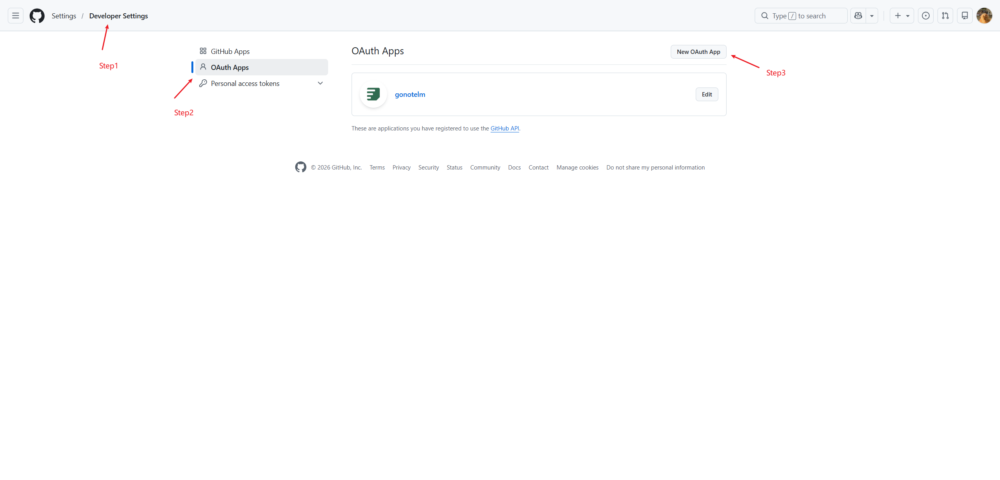
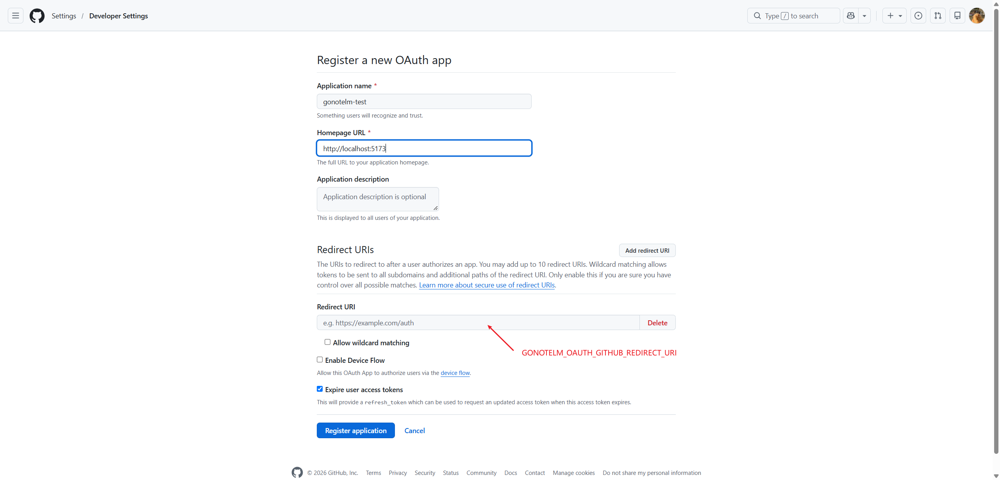
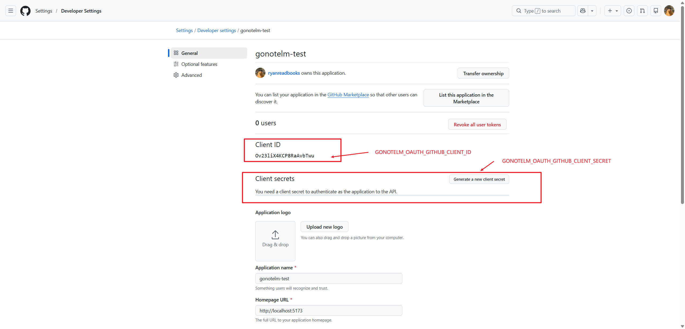

# GitHub

[English](README.md) | 简体中文

GoNoteLM 通过 GitHub OAuth App 登录。后端走 OAuth2 授权码 + PKCE 流程，拿到 code 后通过 GitHub REST API 读取用户资料。GitHub 在这里只提供 OAuth2，不走 OIDC，因此没有 `id_token` 需要校验。

## 1. 创建 OAuth App

1. 打开 GitHub 的 **Settings → Developer settings → OAuth Apps**。

   

2. 点 **New OAuth App**，按下表填写：

   | 字段 | 本地开发 |
   | --- | --- |
   | Application name | `gonotelm-dev`，随便填 |
   | Homepage URL | `http://127.0.0.1:5173` |
   | Authorization callback URL | `http://127.0.0.1:7099/api/v1/auth/callback/github` |

   callback 必须与 `GONOTELM_OAUTH_GITHUB_REDIRECT_URI` 的值相同。

   

3. 点 **Register application**，再点 **Generate a new client secret**，复制 Client ID 和 secret。secret 只显示这一次。

   

## 2. 配置后端

`.env` 里加上：

```env
GONOTELM_OAUTH_GITHUB_CLIENT_ID=...
GONOTELM_OAUTH_GITHUB_CLIENT_SECRET=...
GONOTELM_OAUTH_GITHUB_REDIRECT_URI=http://127.0.0.1:7099/api/v1/auth/callback/github
```

- `GONOTELM_OAUTH_GITHUB_REDIRECT_URI` 可以留空。`etc/notelm.toml.tpl` 里的默认值就是上面的本地地址，只有 callback 不同时才需要设置。
- Client ID 和 client secret 缺一不可。少任意一个，这个 provider 在启动时就会被跳过（notelm 日志会打印 `skip login provider without credentials`），`/api/v1/auth/providers` 也不会返回 `github`。
- 默认 scope 为 `read:user` 和 `user:email`。如果用户把邮箱设为私密，只有带上 `user:email` 才能拿到已验证的地址，所以不要删掉。
- `[idp.github]` 中的 `authEndpoint` / `tokenEndpoint` 保持为空即可，程序会使用 GitHub 默认的授权和 token 地址。只有做测试或走代理时才需要填。
- 修改 `.env` 后需要重启 notelm。`make run-notelm` 会自动读取该文件。

## 3. 验证

先确认 provider 已经注册：

```bash
curl -s http://127.0.0.1:7099/api/v1/auth/providers
# {"code":0,"msg":"ok","data":{"providers":[{"name":"github"}],"password_enabled":true}}
```

然后在浏览器中发起登录：

```text
http://127.0.0.1:7099/api/v1/auth/login?login_provider=github&login_from=web
```

`login_from=web` 是目前唯一支持的设备类型。用户在 GitHub 完成授权后会跳回 `/api/v1/auth/callback/github`，callback 写入 `gnlm_user_sid` session cookie，再重定向到 `return_to`；没有传就回到 `/`。如果要直接落到某个页面，可以加 `&return_to=/notebooks`，但该值必须是相对路径，或者 origin 位于 `GONOTELM_AUTH_RETURN_TO_ALLOW_ORIGINS` 白名单中的绝对 URL。

通过 Web UI 登录时走的是同一个接口（经 `/api` 代理），无需额外配置。

## 4. 生产环境

1. 新建一个 OAuth App（也可以直接修改开发环境用的那个），填入线上地址：

   - Homepage URL: `https://YOUR_DOMAIN`
   - Authorization callback URL: `https://YOUR_DOMAIN/api/v1/auth/callback/github`

2. 让后端指向同一个 callback：

   ```env
   GONOTELM_OAUTH_GITHUB_REDIRECT_URI=https://YOUR_DOMAIN/api/v1/auth/callback/github
   ```

   两处必须完全一致，否则 GitHub 会在 code 到达 GoNoteLM 之前直接拒绝请求。

3. 把 Web 的 origin 加入 `return_to` 白名单：

   ```env
   GONOTELM_AUTH_RETURN_TO_ALLOW_ORIGINS=https://YOUR_DOMAIN
   ```

   白名单之外的绝对 `return_to` 会返回 `invalid return_to`（code 1000）；相对路径不受此限制。

4. API 必须通过 HTTPS 提供服务。session cookie 带有 `Secure`、`HttpOnly`、`SameSite=Lax`；GitHub 跳回 callback 属于顶层跳转，只有 `Lax` 才能让浏览器带上这个 cookie。

每个环境都需要各自的 callback：可以分别创建 OAuth App，也可以把多个地址加入同一个 App 的 redirect URI（GitHub 最多支持 10 个）。

## 常见问题

### 界面没有显示 GitHub 按钮

Client ID 或 client secret 为空时，`/api/v1/auth/providers` 不会返回 `github`。先检查 notelm 日志中是否有 `skip login provider without credentials`，再确认启动的进程确实读取了 `.env`。

### GitHub 提示 `redirect_uri_mismatch`

环境变量中的地址与 OAuth App 中登记的 callback 不一致。请逐项核对 scheme、host、port 和 path；`127.0.0.1` 与 `localhost` 是两个不同的 host。

### 登录成功，但界面仍显示未登录

session cookie 属于提供 callback 的 host。callback 默认在 `127.0.0.1` 上，因此 Web UI 也要用 `http://127.0.0.1:5173` 打开。如果希望使用 `localhost`，需要把 `http://localhost:7099/api/v1/auth/callback/github` 登记为 callback，并把环境变量设为同一个值。

### `oauth state not found` 或 `oauth state mismatch`

`_gnlm_oauth_state` cookie 只能使用一次，10 分钟后失效。请从 `/api/v1/auth/login` 重新发起流程，不要直接刷新 callback 地址；同时确认浏览器没有拦截该 API host 的 cookie。

### callback 失败后跳转到登录页

callback 失败时不会返回 JSON，而是携带 `reason`、`provider` 参数跳转到 `GONOTELM_AUTH_LOGIN_ERROR_URL`。具体原因（token 交换失败、读取资料失败）记录在 notelm 日志中。
