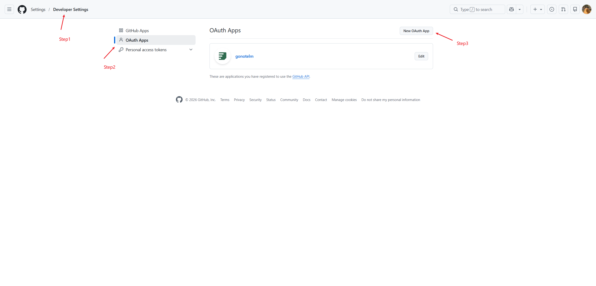
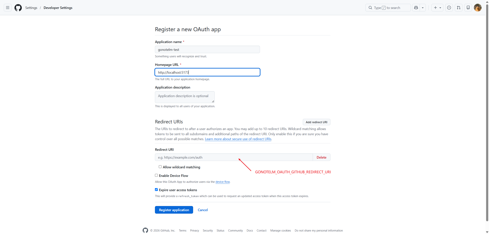
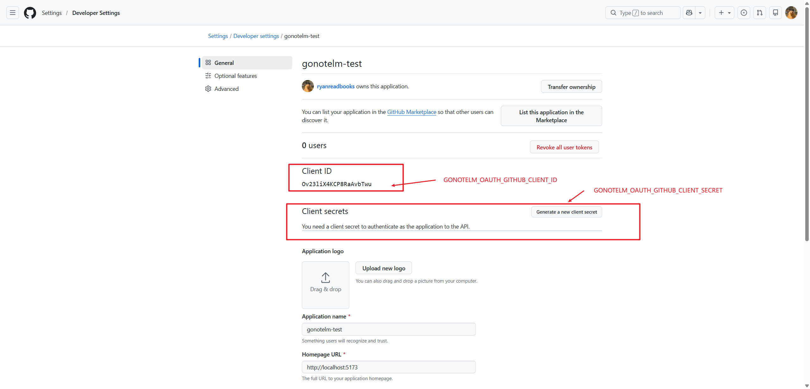

# GitHub

GoNoteLM signs users in with a GitHub OAuth App. The backend runs the OAuth2 authorization-code flow with PKCE and reads the profile from GitHub's REST API; GitHub is not an OIDC provider here, so there is no `id_token` to verify.

## 1. Create an OAuth App

1. In GitHub, open **Settings → Developer settings → OAuth Apps**.

   

2. Click **New OAuth App** and fill in:

   | Field | Local development |
   | --- | --- |
   | Application name | `gonotelm-dev` (anything works) |
   | Homepage URL | `http://127.0.0.1:5173` |
   | Authorization callback URL | `http://127.0.0.1:7099/api/v1/auth/callback/github` |

   The callback URL must be the value of `GONOTELM_OAUTH_GITHUB_REDIRECT_URI`.

   

3. Click **Register application**, then **Generate a new client secret** and copy both credentials. The secret is shown only once.

   

## 2. Configure the backend

Add these to `.env`:

```env
GONOTELM_OAUTH_GITHUB_CLIENT_ID=...
GONOTELM_OAUTH_GITHUB_CLIENT_SECRET=...
GONOTELM_OAUTH_GITHUB_REDIRECT_URI=http://127.0.0.1:7099/api/v1/auth/callback/github
```

- `GONOTELM_OAUTH_GITHUB_REDIRECT_URI` is optional. The default in `etc/notelm.toml.tpl` is already `http://127.0.0.1:7099/api/v1/auth/callback/github`, so only set it when the callback differs.
- Client ID and client secret must both be set. A provider missing either is skipped at startup — notelm logs `skip login provider without credentials` — and never appears in `/api/v1/auth/providers`.
- The default scopes are `read:user` and `user:email`. `user:email` is what resolves the verified address when the user keeps their email private; do not drop it.
- `authEndpoint` / `tokenEndpoint` in `[idp.github]` can stay empty. They fall back to `https://github.com/login/oauth/authorize` and `https://github.com/login/oauth/access_token`, and exist only for tests or a proxy.
- Restart notelm after editing `.env`; `make run-notelm` loads the file automatically.

## 3. Verify

Check that the provider is registered:

```bash
curl -s http://127.0.0.1:7099/api/v1/auth/providers
# {"code":0,"msg":"ok","data":{"providers":[{"name":"github"}],"password_enabled":true}}
```

Then start the flow in a browser:

```text
http://127.0.0.1:7099/api/v1/auth/login?login_provider=github&login_from=web
```

`login_from=web` is the only device type accepted today. GitHub asks for consent and redirects to `/api/v1/auth/callback/github`; the callback sets the `gnlm_user_sid` session cookie and sends the browser to `return_to` (or `/`). Add `&return_to=/notebooks` to land on a specific page — it must be a relative path or an absolute URL whose origin is listed in `GONOTELM_AUTH_RETURN_TO_ALLOW_ORIGINS`.

The web UI drives the same endpoint through its `/api` proxy, so signing in from the UI needs no extra configuration.

## 4. Production

1. Create a separate OAuth App (or edit the development one) with the public URLs:

   - Homepage URL: `https://YOUR_DOMAIN`
   - Authorization callback URL: `https://YOUR_DOMAIN/api/v1/auth/callback/github`

2. Point the backend at the same callback:

   ```env
   GONOTELM_OAUTH_GITHUB_REDIRECT_URI=https://YOUR_DOMAIN/api/v1/auth/callback/github
   ```

   It must match the callback registered on GitHub, otherwise GitHub rejects the request before any code reaches GoNoteLM.

3. Allow the web origin for `return_to`:

   ```env
   GONOTELM_AUTH_RETURN_TO_ALLOW_ORIGINS=https://YOUR_DOMAIN
   ```

   Absolute `return_to` values outside this list are rejected as `invalid return_to` (code 1000). Relative paths always pass.

4. Serve the API over HTTPS. The session cookie is `Secure`, `HttpOnly`, and `SameSite=Lax` — `Lax` is what lets it survive GitHub's top-level redirect back to the callback.

Each environment needs its own callback URL, either as a second OAuth App or as one of the extra redirect URIs on the same app (GitHub allows up to 10).

## Troubleshooting

### The GitHub button never appears

`/api/v1/auth/providers` omits `github` when the client ID or the client secret is empty. Check the notelm log for `skip login provider without credentials`, and confirm the process you started actually loaded `.env`.

### GitHub reports `redirect_uri_mismatch`

The env var and the callback registered on the OAuth App differ. Compare scheme, host, port, and path; `127.0.0.1` and `localhost` are different hosts.

### Login succeeds but the UI still looks signed out

The session cookie belongs to the host that served the callback. With the default callback on `127.0.0.1`, browse the web UI at `http://127.0.0.1:5173`. If you prefer `localhost` for the UI, register `http://localhost:7099/api/v1/auth/callback/github` and set `GONOTELM_OAUTH_GITHUB_REDIRECT_URI` to that value as well.

### `oauth state not found` or `oauth state mismatch`

The `_gnlm_oauth_state` cookie is one-time and expires after 10 minutes. Restart the flow from `/api/v1/auth/login` in the same browser profile instead of reloading the callback URL, and make sure the browser is not blocking cookies for the API host.

### Callback failures land on the login page

A failed callback redirects to `GONOTELM_AUTH_LOGIN_ERROR_URL` with `reason` and `provider` query parameters instead of returning JSON. The notelm log carries the underlying token-exchange or profile error.
